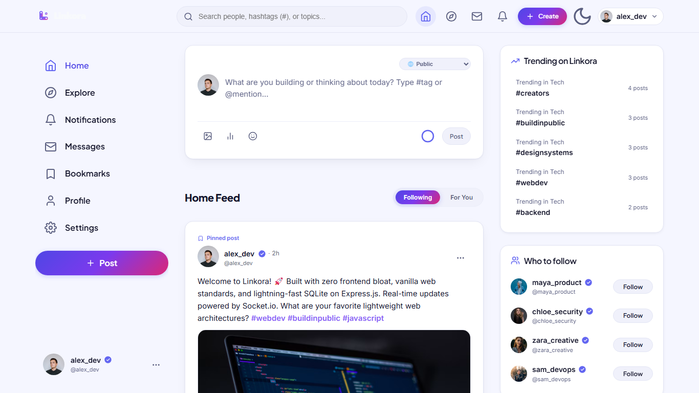
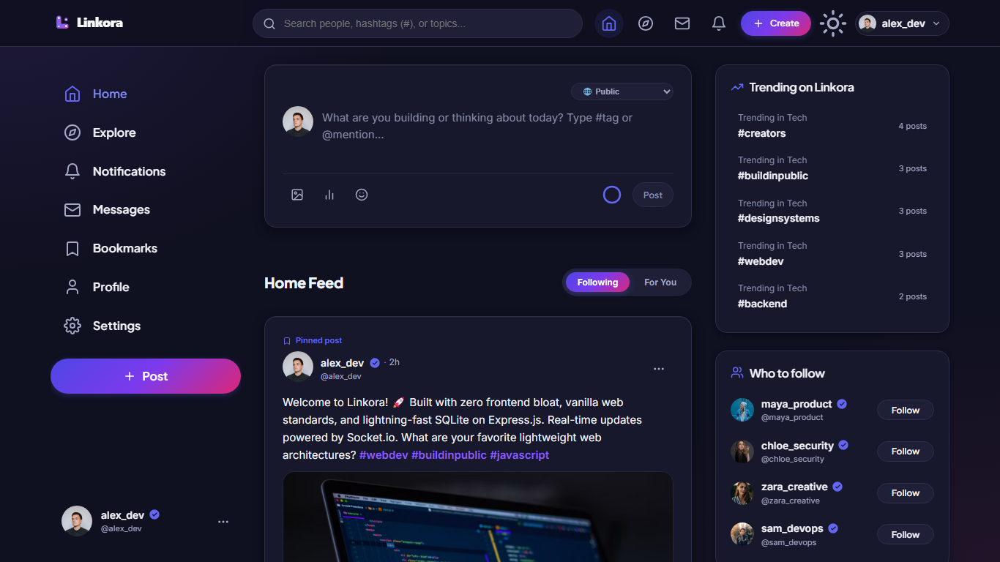
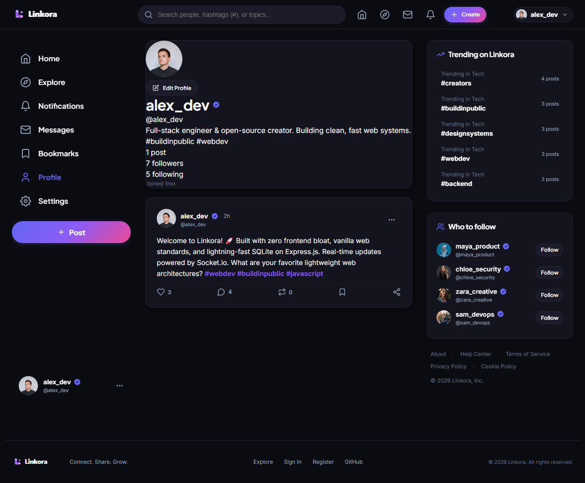
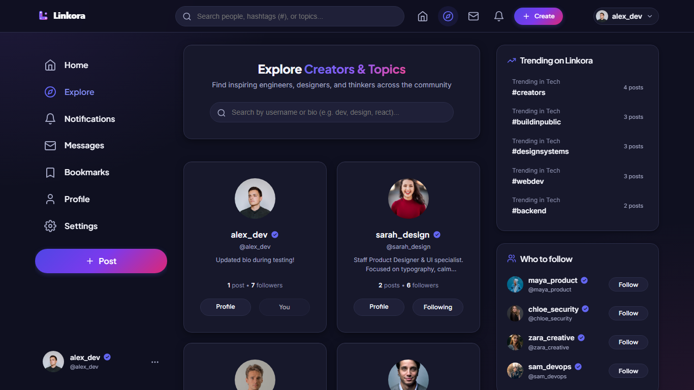
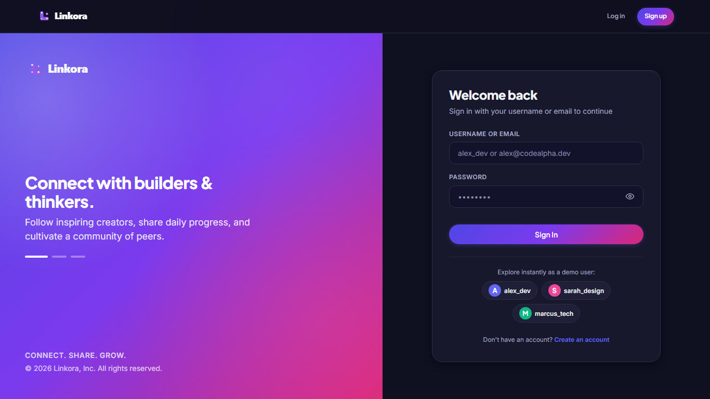

<p align="center">
  
</p>

<p align="center">
  <strong>Connect. Share. Grow.</strong><br>
  A modern, minimalist full-stack social media platform for builders and creators.
</p>

<p align="center">
  
  
  
  
  
  
</p>

---

## Overview

**Linkora** is a refined, high-performance social media application designed without client-side framework overhead. Built using vanilla HTML5, CSS (`theme.css`), and JavaScript (ES6+), served directly by Express.js with a fast, zero-configuration SQLite backend via `better-sqlite3`.

The interface features a curated color system with a deep indigo dark theme (`#0F1020` with soft ambient radial glows) and an accessible clean light theme (`#F5F6FF`), modern typography pairing **Plus Jakarta Sans** for crisp headings and **Inter** for readable body copy, real-time optimistic interactions, and complete session security with JWT in `httpOnly` cookies.

---

## Key Features

1. **Posts & Media**
   - 280-character post composer with real-time character counting and threshold warning.
   - Image attachment upload and preview with Sharp-optimized WebP processing.
   - Dedicated post detail view (`/post/:id`) with permalinks.
   - Post author management: edit post content and author-only post deletion cascading to comments and likes.

2. **Interactive Polls**
   - Built-in multi-choice polls with customizable durations (up to 7 days).
   - Real-time vote tallies, percentage bars, and live countdown timer until poll expiration.
   - One-vote-per-user enforcement with persistent vote states.

3. **Hashtags & Trending**
   - Automatic hashtag parsing (`#tag`) with dedicated link styling.
   - Trending hashtags sidebar showing popular topics and post frequencies.
   - Filter feeds directly by clicking any hashtag.

4. **Bookmarks & Reposts**
   - One-click bookmarking to save posts to a private reading list.
   - Reposting system with instant repost count updates.

5. **Comments & Threaded Replies**
   - In-place expandable comments drawer and dedicated post discussion threads.
   - Multi-level nested replies (`parent_id`) for coherent community conversations.
   - Comment like system and author-only comment deletion.

6. **Likes & Follow System**
   - Optimistic UI for instant like/unlike toggling with automatic rollback on error.
   - Complete Follow/Unfollow mechanics backed by foreign-keyed SQLite relational tables.
   - Real-time follower and following counter synchronizations.

7. **Creator Discovery & Profiles**
   - Discover page with debounced search by username or bio.
   - Intelligent "Suggested Creators" algorithm excluding yourself and accounts you already follow.
   - Profile dashboards with cover banners, avatar overlapping rings, bio editors, verified badges, and filterable tabs (Posts, Replies, Media, Likes).

8. **Theme System & Design Aesthetics**
   - Instant toggle between Deep Indigo Dark Mode and Crisp Light Mode with `localStorage` persistence and `prefers-color-scheme` support.
   - Verified badge styling for prominent creator accounts.
   - Fully responsive design engineered for mobile (360px), tablet (768px), and desktop (1280px+).

---

## CodeAlpha Task 2 Requirements

This application was developed to fulfill and exceed all specifications for **CodeAlpha Task 2 (Social Media Platform)**:

| Requirement Area | Implementation in Linkora |
| :--- | :--- |
| **User Profiles** | Dedicated profile pages (`profile.html` & `/api/users/:username`) featuring avatar, bio, join date, post counts, followers/following counts, and editable profile modal (`PUT /api/users/me`). |
| **Posts & Comments** | Full CRUD for posts with text, images, and polls (`routes/posts.js`). Multi-level comments and nested replies (`routes/comments.js`) with instant UI updates. |
| **Like & Follow System** | Relational `likes`, `comment_likes`, and `follows` tables in SQLite. Dedicated endpoints for liking (`POST /api/posts/:id/like`) and following (`POST /api/users/:id/follow`). |
| **Frontend Technologies** | Pure semantic **HTML5**, modern **CSS** design tokens in `public/css/theme.css`, and modular **Vanilla JavaScript** (no heavy client frameworks). |
| **Backend Framework** | **Express.js** REST API structured modularly under `routes/` (`auth.js`, `users.js`, `posts.js`, `comments.js`, `upload.js`) with security middlewares and validation. |
| **Database Architecture** | Relational **SQLite** database using `better-sqlite3` with foreign keys enabled, WAL mode, transaction support, and normalized schema (`db/schema.sql`). |

---

## Tech Stack

| Layer | Technology |
| :--- | :--- |
| **Frontend** | Vanilla HTML5, Vanilla JavaScript (ES6+), `theme.css` design system |
| **Typography** | Plus Jakarta Sans (Headings 600-800), Inter (Body 400-600) via Google Fonts |
| **Icons** | Lucide SVG icons (dynamic `currentColor` inheritance) |
| **Backend** | Node.js, Express.js (REST API) |
| **Real-time** | Socket.io |
| **Image Processing** | Multer, Sharp (WebP conversion and resizing) |
| **Database** | SQLite via `better-sqlite3` (foreign keys enabled, WAL journal mode) |
| **Authentication** | JSON Web Tokens (JWT) stored in secure `httpOnly` cookies, `bcryptjs` |
| **Validation** | `express-validator` |

---

## Project Structure

```text
CodeAlpha_SocialMediaPlatform/
├── server.js               # Express application entry point, Socket.io & page routing
├── package.json            # Project definition, scripts, and dependencies
├── test-api.js             # Automated API integration test suite
├── generate-assets.js      # Brand asset generator (SVG, PNG, ICO)
├── LICENSE                 # MIT License file
├── .env.example            # Environment variables configuration template
├── .gitignore              # Git ignore rules
├── README.md               # Project documentation
├── db/
│   ├── database.js         # SQLite connection with WAL mode & foreign key pragma
│   ├── schema.sql          # Database tables, foreign key constraints, & indexes
│   └── seed.js             # Demo accounts and initial community data
├── middleware/
│   ├── auth.js             # JWT verification from httpOnly cookies (requireAuth, optionalAuth)
│   └── validate.js         # express-validator error formatting middleware
├── routes/
│   ├── auth.js             # /api/auth (register, login, logout, me)
│   ├── users.js            # /api/users (profile, follow toggle, search, suggestions, mute, block)
│   ├── posts.js            # /api/posts (feed, create, get, edit, delete, like, bookmark, repost, polls)
│   ├── comments.js         # /api/comments (delete, edit, like)
│   └── upload.js           # /api/upload (secure image uploads via Multer & Sharp)
├── public/
│   ├── index.html          # Main feed & post composer view
│   ├── login.html          # Sign-in authentication page
│   ├── register.html       # Account registration page
│   ├── profile.html        # Creator profile, post streams, & bio editor
│   ├── discover.html       # Creator search & suggested creators
│   ├── post.html           # Single post permalink view & discussion thread
│   ├── assets/             # Logos (light/dark/adaptive), favicons, touch icons, OG image
│   ├── css/
│   │   └── theme.css       # Unified design tokens, theme palettes, and utility classes
│   └── js/
│       ├── api.js          # Centralized fetch API client wrapper
│       ├── utils.js        # Theme manager, toast notifications, formatting, pluralization
│       ├── nav.js          # Header navigation, theme toggle, mobile drawers
│       ├── feed.js         # Feed controller, post composer, polls, & interactions
│       ├── post.js         # Single post thread viewer & comment controller
│       ├── profile.js      # Profile views, tab switching, & edit modals
│       ├── discover.js     # Creator discovery, search debounce, & follow actions
│       └── auth.js         # Login/register form submission & validation
├── screenshots/            # Application interface preview screenshots
│   ├── feed-light.png      # Feed page in light theme
│   ├── feed-dark.png       # Feed page in deep indigo dark theme
│   ├── profile.png         # Creator profile page with cover and stats
│   ├── discover.png        # Discover and search interface
│   └── login.png           # Authentication view with brand panel
└── scripts/
    ├── class-audit.js      # Static CSS class consistency checker
    └── screenshot.js       # Automated multi-viewport visual test runner
```

---

## REST API Endpoints

All endpoints are mounted under the `/api` prefix.

### Authentication (`/api/auth`)
- `POST /api/auth/register` - Create a new user account
- `POST /api/auth/login` - Authenticate credentials and receive `httpOnly` JWT cookie
- `POST /api/auth/logout` - Clear authentication session cookie
- `GET /api/auth/me` - Retrieve current session user profile and statistics

### Users & Relationships (`/api/users`)
- `GET /api/users` - Search creators by query (`?search=`) or list discoverable users
- `GET /api/users?suggested=true` - Retrieve suggested creators (excluding self and existing follows)
- `GET /api/users/:username` - Get user profile details, follow stats, and authored posts
- `PUT /api/users/me` - Update current user's bio and avatar image URL
- `POST /api/users/:id/follow` - Toggle follow/unfollow status for a target creator
- `GET /api/users/:id/followers` - List all followers for a specific user
- `GET /api/users/:id/following` - List all creators followed by a specific user
- `POST /api/users/:id/mute` - Toggle mute status for a target user
- `POST /api/users/:id/block` - Toggle block status for a target user (removes follow links)

### Posts & Interactions (`/api/posts`)
- `GET /api/posts/feed` - Retrieve personalized feed (`filter=for-you|following|media|bookmarks`, `tag=`)
- `POST /api/posts` - Create post (max 280 characters, optional images, polls)
- `GET /api/posts/trending/hashtags` - Retrieve trending hashtags with post counts
- `GET /api/posts/:id` - Fetch single post details with media, poll data, and comment counts
- `PUT /api/posts/:id` - Edit post content (author only)
- `DELETE /api/posts/:id` - Delete post and cascade delete comments/likes (author only)
- `POST /api/posts/:id/like` - Toggle like/unlike on post
- `POST /api/posts/:id/bookmark` - Toggle bookmark save on post
- `POST /api/posts/:id/repost` - Toggle repost on post
- `POST /api/posts/:id/pin` - Toggle pin on author's profile
- `POST /api/posts/:id/poll/vote` - Cast vote on an active poll option
- `POST /api/posts/:id/report` - Report a post for moderation
- `GET /api/posts/:id/comments` - Fetch threaded comments for a post
- `POST /api/posts/:id/comments` - Add comment or nested reply (`parent_id`)

### Comments (`/api/comments`)
- `DELETE /api/comments/:id` - Delete comment (author only)
- `PUT /api/comments/:id` - Edit comment content (author only)
- `POST /api/comments/:id/like` - Toggle like on comment

### Uploads (`/api/upload`)
- `POST /api/upload` - Secure multipart image upload with Sharp compression and WebP conversion

---

## Screenshots

<p align="center">
  
  <br />
  <em>Personalized feed with post composer, trending hashtags, and suggested creators in Light Theme.</em>
</p>

<p align="center">
  
  <br />
  <em>Deep indigo dark theme featuring ambient violet and pink glows and interactive cards.</em>
</p>

<p align="center">
  
  <br />
  <em>Creator profile dashboard featuring cover banner, overlapping avatar ring, verified badge, and categorized tabs.</em>
</p>

<p align="center">
  
  <br />
  <em>Discover page with live creator search and suggested creator follow recommendations.</em>
</p>

<p align="center">
  
  <br />
  <em>Authentication portal with branded showcase panel and one-click demo credentials.</em>
</p>

---

## Getting Started

### 1. Prerequisites
- **Node.js** (v18.x or later)
- **npm** (v9.x or later)

### 2. Setup & Installation
```bash
# Clone the repository
git clone https://github.com/generalareas9-sys/CodeAlpha_SocialMediaPlatform.git
cd CodeAlpha_SocialMediaPlatform

# Install dependencies
npm install

# Seed the database with demo accounts and content
npm run seed

# Start the application
npm start
```

Visit **[http://localhost:5000](http://localhost:5000)** in your browser.

For local development with automatic file reload:
```bash
npm run dev
```

---

## Demo Accounts

You can test immediately using any of the pre-configured accounts (click on any quick-login chip on the login page):

| Username | Email | Password | Role |
| :--- | :--- | :--- | :--- |
| **`alex_dev`** | `alex@linkora.dev` | `password123` | Full-stack Engineer |
| **`sarah_design`** | `sarah@linkora.dev` | `password123` | Product & UI Designer |
| **`marcus_tech`** | `marcus@linkora.dev` | `password123` | Cloud Architect & DevOps |

---

## Automated Tests

Run the complete integration test suite:
```bash
npm test
```

Verifies authentication flows, 280-character validation limits, like/follow mechanics, cascade deletions, and ownership authorization.

---

## License

This project is licensed under the MIT License - see the [LICENSE](LICENSE) file for details.

Copyright (c) 2026 Osman Seid Ebrahim.
